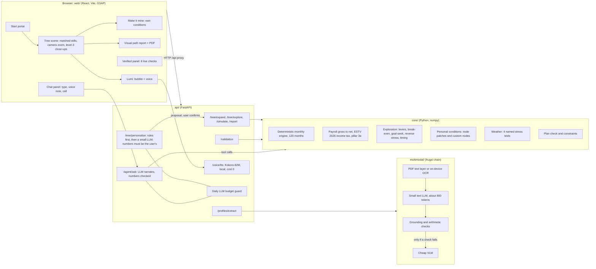

# Cigala: every choice grows a different tree

**A financial twin for students. See what each life decision does to your next ten years before you take it, then tell it what is different about *your* life and watch that branch re-grow. A tested, deterministic engine produces every financial result. Lumi, the guide, explains them and never recommends.**

LauzHack 2026 (EPFL) · team cigala · challenges: **UBS AI Financial Twin** (main), **AXA Frugal multimodal AI**, **IMC Tech for Good**.

> TODO (team): the product name is not final. Title options are in [`docs/submission/form.md`](docs/submission/form.md).

> **Every engine figure on this page comes from [`scripts/pitch_figures.py`](scripts/pitch_figures.py)** (engine `core-1.1`, Alexia's demo profile, default assumptions, Sat 21 Nov 21:55, master `64fced9`). The engine is still being improved tonight, so re-run `python scripts/pitch_figures.py` before submitting and update the numbers here, in [`docs/pitch.md`](docs/pitch.md) and in [`docs/submission/`](docs/submission/).

## In 30 seconds

Alexia is 20 and studies in Lausanne. She has CHF 8,000 saved and three options: start working, do a master's, or move abroad. A spreadsheet can't show her where each path breaks, and a chatbot invents numbers. She can't afford a financial adviser.

Cigala draws her situation as a **tree of life**:

- **Roots** are who she is. Fill them in with a short questionnaire, by dropping a payslip photo, bank statement or rental contract into a frugal multimodal pipeline, or by voice.
- **Trunk** is today.
- **Branches** are her decisions. Each branch is a fully specified *if this, then that* world, simulated month by month for 120 months with the official 2026 income tax of her city (and, for gross salaries, Swiss payroll deductions).
- **Weather** is what she doesn't choose: recession, inflation, a market crash, job loss or a franc move. She sets it on the tree itself (start month, duration), and every card recomputes. These are selected what-ifs, not an exhaustive list of risks.

She picks a branch and the camera flies into it. Its sub-choices grow, and the branches she passed stay greyed out so she can compare. Each card shows a **plan check** (does it hold?) and **what it trades** against its siblings. On every node she can ask *what would have to be true*: break-even salary, goal-seek, the smallest shock that breaks the plan, the cost of waiting a year, which assumption matters most, and *what would fix it* (the smallest change that closes a funding gap). She can pin options from different branches with **Add to comparison** and see them side by side on a spec-sheet page.

Then she makes it hers. She tells it, by voice or text, *"I'd get a CHF 600/month scholarship"*. Deterministic rules (EN/ES/FR/DE) turn common phrasings into a change the engine can simulate, using only numbers she said, and a small model handles the rest. She confirms, and that branch and everything below it re-grow, either as a change to the branch or as a new branch to compare. At the end of a branch she opens a visual path report she can save as a PDF: what would fix it, a two-lever *room to move* heatmap, and what changes if she starts later. It is an exploration, not a forecast, and never advice.

## Screenshots

> TODO (team): capture these on the demo laptop (`http://127.0.0.1:5175`) and save them in `docs/submission/screenshots/`. Add the 2-minute backup video link here (shot list: [`docs/submission/video.md`](docs/submission/video.md)).

| | |
|---|---|
|  *Start portal* |  *Branch cards: plan check and what it trades; past paths greyed* |
|  *Levers, break-even, reverse stress, timing* |  *Make it mine: her own condition, confirmed, re-grows the branch* |
|  *Visual path report: what would fix it, room to move, start later* |  *Verified: six live engine checks* |
|  *Comparison: options from any branch, side by side* |  *Weather on the tree: if a recession starts in month 12…* |

## How it works



- **`core/`** produces every financial result. It covers cash, investments, a locked pillar 3a account and fixed-payment loans; a payroll layer for gross salaries; the official ESTV 2026 income tax for the city, canton and household, including moves of tax residence; EUR amounts abroad; inflation and wage growth; and one-off costs and incomes. Since #77 the tree adapts to the user's own roots: amounts marked as relative to the profile (income kept while studying, the student room, living costs) move with it, while market figures (salaries, flat rents, tuition) stay. Accounting identities are checked on every run. Personal conditions arrive as `node_patches` (a change to a branch that its whole subtree inherits) or `custom_nodes` (a new option to compare). Also: combined decisions, two-lever surfaces, smallest-change search and a start-later scan. Pure functions, JSON in and JSON out. See [`core/README.md`](core/README.md) and the honest self-audit in [`core/ENGINE_AUDIT.md`](core/ENGINE_AUDIT.md).
- **`api/`** is a thin FastAPI layer. `/tree/personalize` turns a sentence or voice clip into a proposal: one patch or new branch, or one clarifying question. Deterministic rules come first and a bounded LLM only after them; the numbers must appear in the user's words and are range-checked. Lumi's agent calls engine tools and only narrates their results. A scope gate and an injection guard sit in front. The agent checks larger numeric claims against tool outputs or user input and falls back to a template when grounding fails; this is not a proof of every claim. A guard rewrites forecast phrasing and drops sentences that recommend. Every paid LLM call goes through a daily budget guard and falls back to a template. See [`api/README.md`](api/README.md).
- **`multimodal/`** turns documents, text and voice into the shared `Profile`, with per-field provenance. See [`multimodal/README.md`](multimodal/README.md).
- **`web/`** is the cinematic tree, Lumi, *Make it mine*, weather on the tree, comparative cards and the comparison page, the chat side panel, the visual path report and the *Verified* panel, in EN, ES, FR and DE with light and dark modes. See [`web/README.md`](web/README.md).
- Shared JSON shapes are in [`docs/contracts.md`](docs/contracts.md).

## What each challenge gets, with evidence

### UBS: AI Financial Twin

The UBS draft rubric weights modelling correctness 25, scenario exploration 20, technical execution and validation 15, UX 15, innovation 15 and responsible design 10.

**1. Personal conditions: the twin becomes yours.** The tree starts from Alexia's synthetic profile, but every branch accepts the user's own situation. On *Do a master's* she says *"I'd get a CHF 600/month scholarship"*. `/tree/personalize` proposes `+CHF 600/month income, months 1–24`, checks that 600 appears in her words, and she confirms it:

| | Before | With her condition |
|---|---|---|
| Do a master's | Needs financing: funding gap of CHF 18,553 from month 7 | Needs financing: funding gap of CHF 3,914 from month 13 |
| Real 10-year net worth, master's | CHF 102,596 | CHF 115,944 |
| Break-even salary after the master's, against starting work | CHF 4,959.51 a month | CHF 4,768.19 a month |
| Study loan of CHF 15,000 (a child of the master's) | Needs financing: gap of CHF 3,538 from month 21 | **Holds: no funding gap, debt within the limit, goals met.** Under all 4 stress scenarios: no funding gap and every dated goal met, but under inflation and job loss it drops below the 3-month buffer target |

With *Add as a new branch*, the same condition becomes *"Do a master's: Scholarship"*, a new option next to the original ones, compared like any other. "Holds in N of 4" always means no funding gap and every dated goal met in that stress scenario. It does not mean every buffer target passes, and the four stresses are selected what-ifs, not a safety guarantee.

**2. A Swiss engine that, under the starter kit's own assumptions, reproduces the kit exactly.**

- **Payroll (for gross salaries).** A gross salary is converted to net with statutory rates (AHV/IV/EO and ALV from BSV, BVG thresholds and age credits from BVG Art. 16) plus explicitly assumed insurer and plan inputs (NBU 1%, the employee's share of BVG credits), which are flagged unverified. Alexia's demo profile gives a net salary, so payroll is not deducted again on her branches.
- **Income tax.** Official ESTV 2026 effective rates (federal + cantonal + communal) for 12 cities × 3 household types, plus tax-residence moves (*Job in Zurich* is taxed in Zurich from month 36; *Move abroad* at a stated flat rate).
- **Pillar 3a.** A capped, tax-deductible contribution, counted as locked in net worth.

Under the starter kit's own assumptions (cash only, no tax, no inflation), the engine returns the kit's three scenarios to the franc. This checks the engine's cash arithmetic against the kit; it says nothing about the Swiss-world results, which use our own assumptions:

| Scenario | Closing cash | Lowest cash | Cash runs short |
|---|---:|---:|---|
| Start working | CHF 152,000 | CHF 9,200 | never |
| Master's degree | CHF 144,600 | CHF −18,600 | month 7 |
| Move abroad | CHF 97,500 | CHF 2,300 | never |

**3. Six live validation checks**, shown in the app's *Verified* panel and served at `GET /validation`. On Sat 21 Nov 21:55, `core.validation()` passed 6/6. They establish the numerical properties stated below (arithmetic, reproducibility, method), not that any scenario will happen:

| Check | What it proves |
|---|---|
| Accounting identities | 40 nodes × 9 checks (cash flow, net-worth change, balance sheet, pillar 3a account, investment account, debt never negative, investments never negative, ordered bands, every assumption sourced); largest error CHF 0.00 |
| Reproducibility | Same inputs and seed give the same trace id. Another seed changes only the optional uncertainty bands, never the deterministic path |
| Monotonicity | Raising the master's tuition never raises cash, in any month |
| Isolation | Changing the cost of moving abroad leaves "Start working" untouched. The riskier portfolio in 1.2.3 does not leak into 1.2.1 |
| UBS starter kit | The three scenarios above, matched exactly |
| Search verified | The break-even salary found by the bounded monotone threshold search (CHF 4,959.51) is re-simulated: at it the master's ends level with working or ahead; CHF 1 lower, it ends behind |

Test suites on Sat 21 Nov 22:00 (master `64fced9`): 154 core and 106 API tests collected; the combined run gave 253 passed, 5 skipped (they need the private UBS kit) and 2 failed. Both failures are speed limits on a busy laptop (0.21 s against 0.20 s, 0.17 s against 0.15 s), not results. Web unit tests: 71 of 71 passed. Re-run on the submission commit with `python scripts/pitch_figures.py --tests`. A calibration harness ([`core/bench/`](core/bench/)) checks the engine against the UBS synthetic ledgers (identities on 1,200 profiles × 24 months, maximum error CHF 0.00) and scores parameters against public Swiss targets only. It never tunes the engine to the synthetic data.

**4. Conditional scenarios first.** We centre conditional, fully specified scenarios so attention stays on the choices; Monte Carlo is an optional simulation lens, off by default, not a forecast. For every node, the engine re-runs itself with inputs moved:

- **levers**: which sourced assumption matters most;
- **break-even**: the salary at which two branches end level, and when one pulls ahead (a bounded monotone threshold search to the cent);
- **goal-seek**: the extra income needed to meet each dated goal;
- **reverse stress**: the smallest one-off cost that breaks the plan;
- **timing**: the same decision 12 or 24 months later, and a start-later scan;
- **what would fix it**: the smallest change per lever that closes the gap; a two-lever *room to move* surface; combined decisions;
- **pillar 3a**: paying into 3a, compared with investing or keeping cash;
- **weather**: recession, high inflation, market crash and job loss (plus franc ±10% on EUR branches), each run as a named deterministic what-if, set from the tree;
- **plan check, feasibility first**: a funding gap makes the branch "Needs financing"; another broken hard limit or a missed goal makes it "Does not hold"; missing only the buffer target makes it "Holds, below the buffer target", whatever the score. Constraints show their margin, first breach month and months in breach. The 33% debt-service limit and the 3-month buffer are editable rules of thumb.

Alexia, default assumptions, all amounts in CHF:

| Branch | Plan check | Under this branch's assumptions |
|---|---|---|
| Today (stay a student) | Needs financing: gap of 22,056 from month 28 | – |
| Start working | Holds, below the 3-month buffer target | Real 10-year net worth 113,708; no funding gap and goals met in 4 of 4 stress scenarios. With 604.83 a month into pillar 3a (the 7,258 yearly cap), nominal net worth rises from 125,605 to 148,865 and tax falls by 22,745, but only 75,521 stays liquid |
| Do a master's | Needs financing: gap of 18,553 from month 7 | Holds in 0 of 4 stress scenarios. Biggest lever: the salary after the master's (4,200 → 5,600 a month moves 10-year net worth from 69,754 to 175,811), and even at the top of that range the cash gap remains. Break-even against working: 4,959.51 a month. Starting a year later: −17,628. Smallest change that closes the gap: +761.93 a month of income, or 18,531.27 once in month 0 |
| … part-time with a 60% job | Holds, below the buffer target | No funding gap; no funding gap and goals met in 4 of 4 stress scenarios |
| Move abroad (EUR amounts at an editable EURCHF) | Does not hold: the "Career transition" goal (CHF 39,366 by month 96) is missed | Real 10-year net worth 48,039 |

**5. Transparent by construction.** The 40-node Alexia tree is editable data, grounded in UBS scenario-catalog ids. Every assumption carries a source, and figures not checked against a primary source are flagged `verified: false`. Statutory payroll rates and the ESTV tables are official; insurer and plan inputs are assumptions. A source-backed figure is still an assumption over a ten-year scenario: the 4% portfolio return, for example, is a prudent team choice informed by historical Swiss returns, not an empirically verified future return. Parameters were calibrated against public Swiss targets only ([`core/bench/OPTIMISATION.md`](core/bench/OPTIMISATION.md)); the search kept the existing defaults. The visual path report states the question and scope, each decision and what it changed, the user's own conditions, the alternatives, stress scenarios, limits and breaches, validation (seed, engine version, trace id) and limitations. Financial results come only from the engine; the LLM guard above concerns Lumi's wording, not the engine.

### AXA: frugal multimodal AI

Roots come from **images and PDFs** (payslip, bank statement, rental contract), **voice** and free text. Personal conditions come from **speech or text**. At every step we use the smallest thing that works:

- **Documents.** The PDF text layer or on-device OCR (RapidOCR) feeds `mistral-small-24b`, which fills a fixed schema (about 800 tokens). Deterministic checks follow: every number must literally appear in the document, and gross − deductions must equal net. Only if a check fails or OCR confidence is low does that one document go to `gemini-3.1-flash-lite`.
- **Personal conditions.** Deterministic rules in EN/ES/FR/DE parse common phrasings with no model at all: *"I'd get a CHF 600/month scholarship during the master's"* becomes one intervention in 0.02 s for USD 0. Only other phrasings go to `qwen3.7-flash` (2.5 s, USD 0.00008 measured), with a timeout and a clarifying question instead of a guess. Numbers are checked against the user's words.
- **Lumi's answers.** A frugal default chain (`qwen3.7-flash`, about USD 0.0001 per answer), with a numeric grounding check and a template fallback. The streaming path uses `claude-haiku-5.5` for a first sentence in about 1.4 s (about USD 0.0008 per answer).
- **Voice.** Speech recognition runs in the browser. TTS is Kokoro-82M running locally: cost 0, streamed sentence by sentence.
- **Cost is visible and capped.** The session's API cost is shown in the chat panel, every paid call is logged with its cost, and a daily LLM budget guard (default USD 2) switches every route to templates when it is reached. Engine routes and TTS are never affected.

Benchmark on 60 synthetic Swiss documents with known ground truth (20 UBS profiles × 3 document types; FR, DE, IT and EN; clean PDF, scan, phone photo, low-res and deliberately hard captures). Cost is what OpenRouter billed. Full results: [`multimodal/benchmark/RESULTS.md`](multimodal/benchmark/RESULTS.md).

| Strategy | Field accuracy | USD per 1,000 docs | Documents sent to a cloud vision model |
|---|---:|---:|---:|
| **Frugal chain (ours)** | **97.7%** | **0.19** | **27%** |
| Same chain without escalation | 83.3% | 0.03 | 0% |
| Cheap VLM on every image (gemini-3.1-flash-lite) | 97.9% | 0.60 | 100% |
| Small open VLM on every image (gemma-3-12b) | 77.7% | 0.16 | 100% |
| Frontier VLM on every image (claude-fable-5.2) | 99.4% | 28.76 | 100% |

- **154× cheaper than the frontier model, for 1.7 points of accuracy.** 73% of documents never need a vision model, and for those only text snippets leave the laptop.
- **Alexia's own three documents** (a payslip photo, a bank-statement PDF and a scanned rental contract, all in French) were read at 100% field accuracy with no escalation, for USD 0.0001 in total.
- **Where we still lose:** tiny, blurred bank statements. There we would rather ask for a better photo than pay 150× on every document. All benchmark experiments together cost USD 2.14.

### IMC: Tech for Good

The people who most need someone to check their plan, such as students, first-generation students and exchange students, are the least likely to have that someone. Cigala is free and works in EN, ES, FR and DE, with a voice that matches the language. Users can talk to it instead of typing, and they can describe their own situation in their own words. Its core (the questionnaire plus the engine) needs no paid model.

Our sourced impact case is in [`docs/impact/README.md`](docs/impact/README.md), checked on 21 Nov 2026:

- **Evidence, with its scope stated.** In the ESN XV ESNsurvey, 35.63% of exchange students reported insufficient funding for living costs, and 62.7% received their grant after departure. A grant is not a budget.
- **A concrete deployment.** An Erasmus Student Network section offers a ten-minute pre-departure session in which a volunteer and a student compare rent and funding choices before the student signs a lease. Unresolved funding gaps are referred to the university's international office. **ESN has not been contacted, and no partnership exists.**
- **A reproducible case.** Nora, a fictional student on exchange at ETH, is a fixture the engine can run. Under the reference room her cash goes negative in month 5 (−CHF 563.46 by January). A confirmed cheaper room or extra funding closes the gap.
- **A falsifiable pilot metric.** With 30 students, does the share who can correctly explain their funding gap rise after ten minutes? A 20-point gain is a target, not a result. No pilot has been run.

## Run it

Requirements: Python 3.12, Node 22.12+ (or 24), and an OpenRouter key for extraction, personal conditions and the LLM agent. Without the key, the engine, tree, report, validation and local TTS still work, and Lumi answers from templates.

```bash
git clone https://github.com/Jlopvs24/lauzhack-26-cigala && cd lauzhack-26-cigala

# 1. Keys (never committed): copy and fill in
cp .env.example .env.local            # OPENROUTER_API_KEY=..., TOGETHER_API_KEY= (optional)

# 2. Backend
pip install -r api/requirements.txt -r multimodal/requirements.txt
python -m api.fetch_models --fp32     # Kokoro TTS model, once (about 310 MB, into api/models/, gitignored)
python -m uvicorn api.main:app --port 8000          # API docs: http://127.0.0.1:8000/docs

# 3. Web
cd web && npm ci && npm run dev       # http://127.0.0.1:5175 (proxies /api to :8000)
```

Checks and figures:

```bash
python -m pytest core/tests api/tests -q            # engine + API
cd web && npm test                                   # web unit tests
python scripts/pitch_figures.py                     # every figure quoted in these docs, from the engine (--tests adds pass counts)
```

Optional, with access to the UBS kit:

```bash
bash scripts/fetch_ubs_kit.sh                        # into vendor/ubs-kit (gitignored, never committed)
python -m core.bench                                 # calibration and benchmark harness
python -m multimodal.gen.generate --people 20       # regenerate the synthetic documents
python -m multimodal.benchmark.run --strategies frugal ocr_llm vlm_cheap vlm_small vlm_large   # paid, about USD 2
```

## Data and licensing

- **UBS starter kit**: "all rights reserved". `scripts/fetch_ubs_kit.sh` downloads it into `vendor/`, which is gitignored, and none of its files are in this repository. We use its Alexia persona, its scenario catalog (cited by id in the tree) and its synthetic profiles. To verify reproduction, `core/validation.py` contains the three scenarios' inputs and published results.
- **Synthetic documents** (`data/synthetic/`, 60 files + `manifest.jsonl`): rendered by our generator ([`multimodal/gen/`](multimodal/gen/)) from UBS synthetic profiles. Names, employers, addresses, IBANs and line items are invented; amounts follow the profiles.
- **Swiss figures**:
  - ESTV 2026 tax tables in `core/data/tax_ch_2026.json`, fetched from the official ESTV calculator with `python -m core.bench.fetch_estv`;
  - 2026 payroll rates from BSV and the BVG, with sources;
  - other defaults in `core/data/assumptions_ch.json`, and the source list in [`core/bench/SOURCES.md`](core/bench/SOURCES.md).

  Unverified figures are flagged `verified: false`.
- **Impact sources**: OECD PISA 2022, ESN XV ESNsurvey, the University of Zurich and ETH Zurich pages, all linked and dated in [`docs/impact/README.md`](docs/impact/README.md).
- **Imagery**: the photoreal tree stills were generated with `google/gemini-3.1-flash-image` from our own prompts and crops; the pipeline and its cost log are in [`web/tree-pipeline/`](web/tree-pipeline/). Lumi is an original character ([`web/assets/character/STYLE.md`](web/assets/character/STYLE.md)).
- **Third-party software and models**: FastAPI, numpy, React, Vite, GSAP, RapidOCR (ONNX), Kokoro-82M (Apache-2.0), pypdfium2, OpenCV; models through OpenRouter (mistral-small-24b, gemini-3.1-flash-lite, qwen3.7-flash, claude-haiku-5.5).
- **License**: the repository does not include an open-source license file yet.

## Limitations and responsible AI

- **Not advice, not a forecast.** Every result reads "if… then…, under these assumptions". Lumi explains trade-offs and never recommends: the agent drops sentences that recommend and rewrites forecast phrasing.
- **The LLM never computes.** Financial results come from engine tools. The agent checks larger numeric claims (100 or more, with a 2% or CHF 1 tolerance; calendar years skipped) against tool outputs or user input and falls back to a template when grounding fails. This is not a proof of every claim: it does not check small numbers, which metric a number is attached to, or qualitative statements. Personal conditions use only numbers that appear in the user's own words. If an amount or duration is missing, the parser asks one question instead of guessing.
- **The model's simplifications are documented** in [`core/README.md`](core/README.md), and [`core/ENGINE_AUDIT.md`](core/ENGINE_AUDIT.md) lists the weaknesses a judge could attack. Examples:
  - tax is paid in the same month, with no arrears; wealth tax and church tax are ignored;
  - abroad uses EUR income and costs converted at an editable EURCHF (constant by default, optional ±10% franc stress), one assumed foreign tax rate, no city-specific living costs, Swiss inflation on EUR amounts, and no stochastic FX;
  - unemployment rules are simplified;
  - shocks in the optional lens are independent;
  - pillar 2 (BVG) is reported but not counted in net worth;
  - source-backed inputs (returns, wage growth, inflation) remain assumptions over ten years, and the six checks test arithmetic and method, not predictive validity.
- **The plan check comes first and the score second.** A funding gap means "Needs financing"; another broken hard limit or a missed goal means "Does not hold"; a buffer-only shortfall means "Holds, below the buffer target", whatever the score. The 33% debt-service limit and the 3-month buffer are editable rules of thumb. Negative cash is shown as an unfunded need, never as an automatic loan.
- **The uncertainty lens is opt-in.** Monte Carlo is a simulation, kept secondary so attention stays on choices. Its results are shares of simulated paths under stated assumptions, labelled "not real-world probabilities". The four named stresses are selected what-ifs, not exhaustive.
- **Synthetic data.** The extraction benchmark uses our own rendered documents, and real documents are messier.
- **Privacy.** For most documents only text leaves the device. A personal condition's sentence goes to a small model through OpenRouter for parsing, and confirmed conditions are stored only in the browser session. Browser speech recognition may use the browser vendor's servers.

## What we built at LauzHack (rule 30)

**Built during the hackathon** (Sat 21 Nov 12:00 – Sun 22 Nov 12:00): everything in `core/`, `api/`, `multimodal/` and `web/`; the 40-node decision tree and its assumptions; personal conditions; the payroll, tax, pillar 3a and EUR models; the profile-aware tree; comparison; weather on the tree; the calibration harness; the synthetic document generator and the AXA benchmark; the tree imagery pipeline and stills; Lumi; the impact case; and these docs. Before kickoff the repository held only the board kit and team rules (commits `5656b87` and `92cd931`, Sat 09:48–09:58). All product code came after 12:00.

**Existing resources we used:**

- **UBS starter kit**: a cash-only scenario script with three scenarios. We used it as a reference our engine must reproduce, not as code.
- **Public data**: ESTV, BSV and the BVG for Swiss rates and tables.
- **Open-source libraries and models**, listed above, used as they are.
- **The multi-agent message-board kit** (`tools/board`, `.claude/hooks`), adapted from [azizu06/hackathon-agent-board](https://github.com/azizu06/hackathon-agent-board), which we used to coordinate. It is not part of the product.

## Team

| Who | Role |
|---|---|
| Juan ([@Jlopvs24](https://github.com/Jlopvs24)) | Lead; engine v1, API and agent, personal conditions, voice, multimodal roots and AXA benchmark, cinematic tree, path report, Lumi, delivery |
| Lluc ([@llucliment](https://github.com/llucliment)) | Financial engine (`core/`) from Sat 16:45: the exploration-first redesign, plan check, live validation, engine audit and calibration, payroll, ESTV tax and pillar 3a; roots, chat and voice UI; IMC impact case |

We built Cigala with AI coding agents (Claude Code, Codex, Antigravity) working in parallel and coordinating through GitHub issues and a pinned message-board issue ([`AGENTS.md`](AGENTS.md)). The humans made the product and modelling decisions ([`docs/plan.md`](docs/plan.md)) and reviewed and merged every PR.
