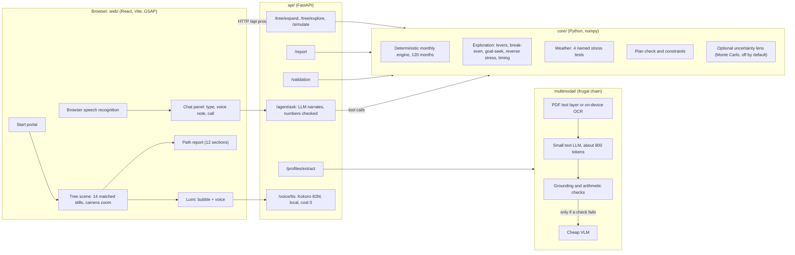

# Cigala: every choice grows a different tree

**A financial twin for students. See what each life decision does to your next ten years before you take it. A tested, deterministic engine produces every number. Lumi, the guide, explains the numbers and never recommends.**

LauzHack 2026 (EPFL) · team cigala · challenges: **UBS AI Financial Twin** (main), **AXA Frugal multimodal AI**, **IMC Tech for Good**.

> TODO (team): the product name is not final. Title options are in [`docs/submission/form.md`](docs/submission/form.md).

## In 30 seconds

Alexia is 20 and studies in Lausanne. She has CHF 8,000 saved and three options: start working, do a master's, or move abroad. A spreadsheet can't show her where each path breaks, and a chatbot invents numbers. She can't afford a financial adviser.

Cigala draws her situation as a **tree of life**:

- **Roots** are who she is. Fill them in with a short questionnaire, by dropping a payslip photo, bank statement or rental contract into a frugal multimodal pipeline, or by voice.
- **Trunk** is today.
- **Branches** are her decisions. Each branch is a fully specified *if this, then that* world, simulated month by month for 120 months.
- **Weather** is what she doesn't choose: recession, inflation, a market crash or job loss, run as named stress tests.

She picks a branch and the camera flies into it. Its sub-choices grow, and the branches she passed stay greyed out so she can compare. On every node she can ask *what would have to be true*: break-even salary, goal-seek, the smallest shock that breaks the plan, the cost of waiting a year, and which assumption matters most. Every assumption is visible, sourced and editable, and the tree recomputes when she changes one. At the end of a branch she opens a path report with 12 sections. It is an exploration, not a forecast, and never advice.

## Screenshots

> TODO (team): capture these from the demo laptop (`http://127.0.0.1:5175`) and save them in `docs/submission/screenshots/`.

| | |
|---|---|
|  *Start portal* |  *Roots read from documents, with source and confidence per field* |
|  *Branches with plan check; pruned paths greyed* |  *Levers, break-even, reverse stress, timing* |
|  *Path report: stress scenarios side by side* |  *Lumi answers by voice; session API cost shown* |

## How it works



- **`core/`** produces every number. It holds the monthly state (cash, investments, fixed-payment loans), income tax, inflation, wage growth, one-offs and auto-liquidation. Accounting identities are checked on every run. Pure functions, JSON in and JSON out. See [`core/README.md`](core/README.md).
- **`api/`** is a thin FastAPI layer. Lumi's agent calls engine tools (`get_node`, `compare_nodes`, `what_if`, `get_exploration`, `what_would_have_to_be_true`). Every number in an answer is checked against tool outputs. A guard rewrites forecast phrasing and drops sentences that recommend, and an answer that fails a check falls back to a template built from engine results. See [`api/README.md`](api/README.md).
- **`multimodal/`** turns documents, text and voice into the shared `Profile`, with per-field provenance. See [`multimodal/README.md`](multimodal/README.md).
- **`web/`** is the cinematic tree, Lumi, the chat panel and the report, in EN, ES, FR and DE with light and dark modes. See [`web/README.md`](web/README.md).
- Shared JSON shapes are in [`docs/contracts.md`](docs/contracts.md).

## What each challenge gets, with evidence

### UBS: AI Financial Twin

The UBS draft rubric weights modelling correctness 25, scenario exploration 20, technical execution and validation 15, UX 15, innovation 15 and responsible design 10. Our answer to each:

**1. A deterministic engine reproduces the UBS starter kit exactly.** Under the kit's own assumptions (cash only), `core.starter` returns the kit's three scenarios to the franc:

| Scenario | Closing cash | Lowest cash | Cash runs short |
|---|---:|---:|---|
| Start working | CHF 152,000 | CHF 9,200 | never |
| Master's degree | CHF 144,600 | CHF −18,600 | month 7 |
| Move abroad | CHF 97,500 | CHF 2,300 | never |

With the kit downloaded, one more test compares the engine with the kit's code month by month (`core/tests`, skipped without the kit).

**2. Six live validation checks.** We ran `core.validation()` on engine `core-1.1` on 21 Nov: 6/6 passed in 1.8 s. The API serves the same data at `GET /validation`, cached for 60 s:

| Check | What it proves |
|---|---|
| Accounting identities | 40 nodes × 8 checks (cash flow, net-worth change, balance sheet, investment account, debt never negative, investments never negative, ordered bands, every assumption sourced); largest error CHF 0.00 |
| Reproducibility | Same inputs and seed give the same trace id. Another seed changes only the optional uncertainty bands, never the deterministic path |
| Monotonicity | Raising the master's tuition never raises cash, in any month (5 levels across its sourced range) |
| Isolation | Changing the cost of moving abroad leaves "Start working" untouched. The riskier portfolio in 1.2.3 does not leak into its sibling 1.2.1 |
| UBS starter kit | The three scenarios above, matched exactly |
| Search verified | The break-even salary found by bisection (CHF 4,844.64) is re-simulated: at it the master's ends level with working or ahead; CHF 1 lower, it ends behind |

The engine and API test suites (`python -m pytest core/tests api/tests -q`) cover the same ground. TODO (team): paste the final pass count from the demo laptop here.

**3. Exploration, not prediction.** UBS asked us to explore possibilities rather than predict, so the core is deterministic and Monte Carlo is an optional lens that stays off by default. For every node the engine re-runs itself with one input moved:

- **levers**: which sourced assumption, moved across its range, changes the outcome most;
- **break-even**: against each sibling, the month this branch pulls ahead, and the salary at which both branches end level;
- **goal-seek**: the extra monthly income needed to meet each dated goal;
- **reverse stress**: the smallest one-off cost in month 0 that breaks the plan;
- **timing**: the same decision 12 or 24 months later;
- **weather**: recession, high inflation, market crash and job loss, each run as a named deterministic what-if;
- **plan check, feasibility first**: any funding gap makes the branch "Needs financing", whatever its score. Constraints (no funding gap, debt-service limit, liquidity buffer, goals) report their margin, first breach month and months in breach.

Alexia, engine `core-1.1`, default assumptions, all amounts in CHF:

| Branch | Plan check | Under this branch's assumptions |
|---|---|---|
| Do a master's | Needs financing: funding gap of 18,835 from month 7 | Holds in 0 of 4 stress scenarios. Biggest lever: the net salary after the master's, which moves 10-year net worth from 69,435 to 189,269 across its range. Break-even salary against starting work: 4,844.64 a month in today's prices. Starting a year later lowers 10-year net worth by 18,789 |
| … with a study loan of 15,000 | Needs financing: gap of 3,820 from month 20 | The loan pushes the gap back and shrinks it, but doesn't close it |
| … part-time with a 60% job | Holds, below the 3-month buffer target | No funding gap. Holds in 4 of 4 stress scenarios. A one-off shock larger than 5,642.51 in month 0 would break it |
| … part-time, employer pays the tuition | Holds: no funding gap, debt within the limit, goals met | Real 10-year net worth 128,570 as planned and 96,535 under high inflation |

**4. Transparent by construction.** The 40-node Alexia tree is editable data ([`core/data/trees/alexia.json`](core/data/trees/alexia.json)). Each node is grounded in UBS scenario-catalog ids. Every assumption carries a source. Figures we could not verify are flagged openly: 8 of the 15 Swiss defaults ([`core/data/assumptions_ch.json`](core/data/assumptions_ch.json)) and 18 of the 24 tree-specific values are marked `verified: false`. The path report has the 12 sections in [`docs/report-spec.md`](docs/report-spec.md), up to *Validation and reproducibility* (seed, engine version, trace id) and *Limitations and responsible design*. No LLM produces a number.

### AXA: frugal multimodal AI

Roots can come from **images and PDFs** (payslip, bank statement, rental contract), **voice** and free text. Instead of sending every image to a frontier model, we run a chain that escalates only when a check fails:

PDF text layer or on-device OCR (RapidOCR) → `mistral-small-24b` fills a fixed JSON schema (about 800 tokens) → deterministic checks (every number must literally appear in the document; gross − deductions = net; rent + charges ≤ total) → only if a check fails or OCR confidence is low, that one document goes to `gemini-3.1-flash-lite`.

Measured on 60 synthetic Swiss documents with known ground truth (20 UBS profiles × 3 document types; FR, DE, IT and EN; clean PDF, scan, phone photo, low-res and deliberately hard captures). Cost is what OpenRouter billed. Full results: [`multimodal/benchmark/RESULTS.md`](multimodal/benchmark/RESULTS.md).

| Strategy | Field accuracy | USD per 1,000 docs | Images sent to a cloud model |
|---|---:|---:|---:|
| **Frugal chain (ours)** | **97.7%** | **0.19** | **27%** |
| Same chain without escalation | 83.3% | 0.03 | 0% |
| Cheap VLM on every image (gemini-3.1-flash-lite) | 97.9% | 0.60 | 100% |
| Small open VLM on every image (gemma-3-12b) | 77.7% | 0.16 | 100% |
| Frontier VLM on every image (claude-fable-5.2) | 99.4% | 28.76 | 100% |

- **154× cheaper than the frontier model, for 1.7 points of accuracy.** 73% of documents never need a vision model.
- **Privacy follows from frugality.** 73% of images never leave the laptop; for those, only text snippets reach the small model.
- **Alexia's own three documents** (a payslip photo, a bank-statement PDF and a scanned rental contract, all in French) were read at 100% field accuracy with no escalation, for about USD 0.0001 in total.
- **Voice is frugal too.** Speech recognition runs in the browser. TTS is Kokoro-82M running locally (cost 0, first sentence in 0.7–1.6 s, measured in [`api/VOICE.md`](api/VOICE.md)). A chat answer costs about USD 0.0001.
- **The session's API cost is shown in the UI**, and every paid call is logged with its cost. All benchmark experiments together cost USD 2.14.
- **Where we still lose:** tiny, blurred bank statements (90.6% vs 97.9% for the frontier model on the hard set). There we would rather ask for a better photo than pay 150× on every document.

### IMC: Tech for Good

The people who most need someone to check their plan, such as students, first-generation students and exchange students, are the least likely to have that someone. Cigala is free and works in EN, ES, FR and DE, with a voice that matches the language. Users can talk to Lumi instead of typing: they can dictate, send a voice note or call. Its core (the questionnaire plus the engine) needs no paid model.

Our sourced impact case is in [`docs/impact/README.md`](docs/impact/README.md), checked on 21 Nov 2026:

- **Evidence, with its scope stated.** In the ESN XV ESNsurvey, 35.63% of exchange students reported insufficient funding for living costs, and 62.7% received their grant after departure. A grant is not a budget.
- **A concrete deployment.** An Erasmus Student Network section offers a ten-minute pre-departure session in which a volunteer and a student compare rent and funding choices before the student signs a lease. Unresolved funding gaps are referred to the university's international office. **ESN has not been contacted, and no partnership exists.**
- **A reproducible case.** Nora, a fictional student on exchange at ETH, is a fixture the engine can run. Under the reference room her cash goes negative in January (−CHF 563.46). A confirmed cheaper room or extra funding closes the gap. A Python snippet in the doc re-checks every figure.
- **A falsifiable pilot metric.** With 30 students, does the share who can correctly explain their funding gap rise after ten minutes? A 20-point gain is a target, not a result. No pilot has been run.

## Run it

Requirements: Python 3.12, Node 22.12+ (or 24), and an OpenRouter key for extraction and the LLM agent. Without the key, the engine, tree, report and local TTS still work, and Lumi answers from templates.

```bash
git clone https://github.com/Jlopvs24/lauzhack-26-cigala && cd lauzhack-26-cigala

# 1. Keys (never committed): copy and fill in
cp .env.example .env.local            # OPENROUTER_API_KEY=..., TOGETHER_API_KEY= (optional)

# 2. Backend
pip install -r api/requirements.txt -r multimodal/requirements.txt
python -m api.fetch_models --fp32     # Kokoro TTS model, once (about 310 MB, into api/models/, gitignored)
python -m uvicorn api.main:app --port 8000          # API docs: http://127.0.0.1:8000/docs

# 3. Web
cd web && npm ci && npm run dev       # http://127.0.0.1:5175 (proxies /api to :8000)
```

Optional, with access to the UBS kit:

```bash
bash scripts/fetch_ubs_kit.sh                        # into vendor/ubs-kit (gitignored, never committed)
python -m multimodal.gen.generate --people 20       # regenerate the synthetic documents
python -m multimodal.benchmark.run --strategies frugal ocr_llm vlm_cheap vlm_small vlm_large   # paid, about USD 2
```

Checks:

```bash
python -m pytest core/tests api/tests -q            # engine + API
python -c "import core, json; print(json.dumps(core.validation(), indent=1))"   # the 6 live checks
cd web && npm test                                   # web unit tests
```

## Data and licensing

- **UBS starter kit**: "all rights reserved". `scripts/fetch_ubs_kit.sh` downloads it into `vendor/`, which is gitignored, and none of its files are in this repository. We use its Alexia persona, its scenario catalog (cited by id in the tree) and its synthetic profiles. To verify reproduction, `core/validation.py` contains the three scenarios' inputs and published results.
- **Synthetic documents** (`data/synthetic/`, 60 files + `manifest.jsonl`): rendered by our generator ([`multimodal/gen/`](multimodal/gen/)) from UBS synthetic profiles. Names, employers, addresses, IBANs and line items are invented; amounts follow the profiles. **TODO (team): confirm with UBS before the repo goes public that documents derived from their synthetic profiles may be published.**
- **Assumptions**: Swiss defaults with source and date in `core/data/assumptions_ch.json`; tree-specific ones in `core/data/trees/alexia.json`. Unverified figures are flagged `verified: false`.
- **Impact sources**: OECD PISA 2022, ESN XV ESNsurvey, the University of Zurich and ETH Zurich pages, all linked and dated in [`docs/impact/README.md`](docs/impact/README.md).
- **Imagery**: the photoreal tree stills were generated with `google/gemini-3.1-flash-image` from our own prompts and crops (USD 2.30, pipeline in [`web/tree-pipeline/`](web/tree-pipeline/)). Lumi is an original character ([`web/assets/character/STYLE.md`](web/assets/character/STYLE.md)).
- **Third-party software and models**: FastAPI, numpy, React, Vite, GSAP, RapidOCR (ONNX), Kokoro-82M (Apache-2.0), pypdfium2, OpenCV; models through OpenRouter (mistral-small-24b, gemini-3.1-flash-lite, qwen3.7-flash, claude-haiku-5.5).
- **License of this code**: TODO (team): no `LICENSE` file yet.

## Limitations and responsible AI

- **Not advice, not a forecast.** Every result reads "if… then…, under these assumptions". Lumi explains trade-offs and never recommends: the agent drops sentences that recommend and rewrites forecast phrasing, and Lumi never points at a branch as "the best".
- **The LLM never computes.** Numbers come from engine tools, and every number in an answer is checked against tool outputs. An answer that fails falls back to a template built from engine results. Known limit: the check verifies numbers, not every qualitative claim.
- **Deliberate model simplifications**, listed in [`core/README.md`](core/README.md): one effective income-tax table (single person, Lausanne) with no wealth tax or pillar 2/3a; one currency; independent shocks; a simplified unemployment-insurance rule; non-financial assets treated as costs.
- **The plan check comes first and the score second.** A funding gap or breached constraint marks a branch "Needs financing" whatever its score. Negative cash is shown as an unfunded need, never as an automatic loan. The health-score weights are a value judgement and are shown openly.
- **The uncertainty lens is opt-in.** Monte Carlo results are shares of simulated paths under stated assumptions, labelled "not real-world probabilities".
- **Synthetic data.** The extraction benchmark uses our own rendered documents, and real documents are messier. On the hard captures we would rather ask for a better photo.
- **Privacy.** For most documents only text leaves the device (73% of images stay local). The live pilot proposal uses synthetic documents and makes no promise that browser speech services keep data on the device. Paid-API caps are not enforced automatically.

## What we built at LauzHack (rule 30)

**Built during the hackathon** (Sat 21 Nov 12:00 – Sun 22 Nov 12:00): everything in `core/`, `api/`, `multimodal/` and `web/`; the 40-node decision tree and its assumptions; the synthetic document generator and the AXA benchmark; the tree imagery pipeline and the 14 stills; Lumi; the impact case; and these docs. Before kickoff the repository held only the board kit and team rules (commits `5656b87` and `92cd931`, Sat 09:48–09:58). All product code came after 12:00.

**Existing resources we used:**

- **UBS starter kit**: a cash-only scenario script with three scenarios. We used it as a reference our engine must reproduce, not as code. Our engine adds income tax, inflation, wage growth, investments, loans, weather, constraints and exploration analyses.
- **Open-source libraries and models**, listed above, used as they are.
- **The multi-agent message-board kit** (`tools/board`, `.claude/hooks`), adapted from [azizu06/hackathon-agent-board](https://github.com/azizu06/hackathon-agent-board), which we used to coordinate. It is not part of the product.

## Team

| Who | Role |
|---|---|
| Juan ([@Jlopvs24](https://github.com/Jlopvs24)) | Lead; engine v1, API and agent, voice, multimodal roots and AXA benchmark, cinematic tree, Lumi, delivery |
| Lluc ([@llucliment](https://github.com/llucliment)) | Financial engine (`core/`) from Sat 16:45: the exploration-first redesign, plan check, branch headlines, report data, live validation; roots, chat and voice UI; IMC impact case |

We built Cigala with AI coding agents (Claude Code, Codex, Antigravity) working in parallel and coordinating through GitHub issues and a pinned message-board issue ([`AGENTS.md`](AGENTS.md)). The humans made the product and modelling decisions ([`docs/plan.md`](docs/plan.md)) and reviewed and merged every PR.
